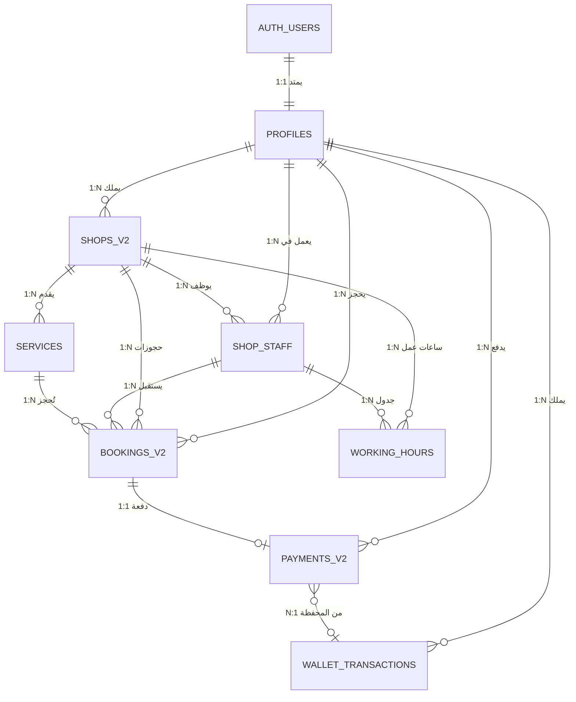

# 🔬 التحليل العميق الشامل للباك إند — منصة حلاق (BarberShop)

> **تاريخ التحليل:** 2026-06-01  
> **قاعدة البيانات:** PostgreSQL 17 (Supabase)  
> **المحلل:** Senior Software Architect  

---

## 📑 فهرس المحتويات

1. [فهم المشروع](#القسم-الأول-فهم-المشروع)
2. [تحليل الجداول](#القسم-الثاني-تحليل-الجداول)
3. [تحليل العلاقات](#القسم-الثالث-تحليل-العلاقات)
4. [تحليل دوال RPC](#القسم-الرابع-تحليل-rpc-functions)
5. [رسم التبعيات بين RPC](#القسم-الخامس-رسم-العلاقات-بين-الـ-rpc)
6. [تحليل Triggers](#القسم-السادس-تحليل-triggers)
7. [تحليل RLS](#القسم-السابع-تحليل-rls)
8. [تحليل نظام الحجز](#القسم-الثامن-تحليل-booking-system)
9. [اكتشاف المشاكل](#القسم-التاسع-اكتشاف-المشاكل)
10. [ماذا يمكن حذفه؟](#القسم-العاشر-ماذا-يمكن-حذفه)
11. [ماذا يحتاج Refactoring؟](#القسم-الحادي-عشر-ماذا-يحتاج-refactoring)
12. [دليل المطور الجديد](#القسم-الثاني-عشر-شرح-الباك-إند-للمطور-الجديد)

---

# القسم الأول: فهم المشروع

## ما نوع المشروع؟

هذا نظام **SaaS لإدارة حجوزات صالونات الحلاقة**. يُتيح للمالك (Owner) إدارة فروع متعددة، كل فرع فيه حلاقين (Barbers) ومديرين (Managers) وخدمات (Services). العميل (Client) يستطيع حجز موعد عبر تطبيق موبايل أو ويب.

## ما المشكلة التي يحلها؟

| المشكلة | الحل |
|---------|------|
| إدارة مواعيد الحلاقين يدوياً وتعارض الحجوزات | محرك حجز ذكي يمنع التعارض تلقائياً |
| عدم معرفة المالك بأداء فروعه | لوحة تحكم بإحصائيات فورية |
| صعوبة إدارة الموظفين عبر فروع متعددة | نظام صلاحيات متعدد الأدوار |
| تجربة حجز سيئة للعميل | اقتراحات ذكية لأفضل المواعيد |
| الدفع النقدي فقط | نظام محفظة رقمية (قيد التطوير) |

## الكيانات الأساسية

المشروع يتكون من **8 كيانات أساسية فعّالة** + **4 جداول قديمة ميتة**:

```
┌─────────────────────────────────────────────────────────────────┐
│                    🔐 Auth (Supabase Auth)                       │
│              auth.users — 21 مستخدم مسجل                        │
│         المصادقة بالبريد الإلكتروني وكلمة المرور فقط            │
└────────────────────────┬────────────────────────────────────────┘
                         │ id (1:1)
                         ▼
┌────────────────────────────────────────────────────────────────┐
│                    👤 Profiles (16 سجل)                        │
│    الملف الشخصي — الاسم، البريد، الهاتف، الدور، المحفظة      │
│    الأدوار: client | barber | manager | owner                  │
└────────┬───────────────┬───────────────────────────────────────┘
         │ owner_id      │ user_id
         ▼               ▼
┌──────────────┐  ┌───────────────┐
│ 🏪 Shops_v2  │  │ 👥 Shop_Staff │
│  (8 فروع)    │←─│   (2 سجل)     │
│  الاسم، العنوان│  │ الدور، الحالة │
│  ساعات العمل  │  └───────┬───────┘
└──┬────┬───┬──┘          │ staff_id
   │    │   │              ▼
   │    │   │     ┌────────────────┐
   │    │   └────→│ ⏰ Working_Hours│
   │    │         │   (11 سجل)     │
   │    │         │ جدول العمل اليومي│
   │    │         └────────────────┘
   │    │
   │    ▼
   │ ┌──────────────┐
   │ │ 📦 Services   │
   │ │  (4 خدمات)    │
   │ │ الاسم، المدة   │
   │ │ السعر          │
   │ └───────┬───────┘
   │         │ service_id
   ▼         ▼
┌────────────────────────────────────────┐
│           📅 Bookings_v2 (29 حجز)      │
│  العميل، الحلاق، الفرع، الخدمة        │
│  التاريخ، وقت البداية، وقت النهاية     │
│  وقت العرض (display_start_time)        │
│  الحالة، طريقة الدفع                   │
└────────────────┬───────────────────────┘
                 │ booking_id
                 ▼
┌────────────────────────────────────────┐
│           💳 Payments_v2 (0 سجل)       │
│  فارغ حالياً — نظام الدفع لم يُفعّل   │
└────────────────┬───────────────────────┘
                 │ wallet_tx_id
                 ▼
┌────────────────────────────────────────┐
│        💰 Wallet_Transactions (0 سجل)  │
│  فارغ حالياً — المحفظة لم تُفعّل      │
└────────────────────────────────────────┘
```

### شرح كل علاقة في الخريطة

| العلاقة | الشرح | لماذا موجودة؟ |
|---------|-------|---------------|
| `auth.users → profiles` | كل مستخدم مسجل له ملف شخصي واحد | لأن Supabase Auth يخزن فقط البريد وكلمة المرور، نحتاج جدول إضافي للبيانات الشخصية والدور |
| `profiles → shops_v2` | المالك يملك فروعاً متعددة | لأن النظام يدعم Multi-Shop Ownership |
| `profiles → shop_staff` | الشخص يمكن أن يكون موظفاً في فرع | لفصل دور الشخص في كل فرع عن دوره العام |
| `shops_v2 → shop_staff` | الفرع فيه موظفين | لربط الحلاقين والمديرين بفروعهم |
| `shops_v2 → services` | كل فرع له خدمات خاصة | لأن الأسعار والخدمات تختلف بين الفروع |
| `shop_staff → working_hours` | كل موظف له ساعات عمل | لأن كل حلاق يمكن أن يكون له جدول مختلف |
| `shops_v2 → working_hours` | الفرع له ساعات عمل افتراضية | كـ fallback إذا لم يُحدد جدول للموظف |
| `bookings_v2 → shops_v2, shop_staff, profiles, services` | الحجز يربط كل شيء معاً | لأن الحجز هو العملية الأساسية التي تجمع العميل بالحلاق بالخدمة بالفرع |
| `payments_v2 → bookings_v2` | كل دفعة مرتبطة بحجز | لتتبع المدفوعات لكل حجز |
| `wallet_transactions → profiles` | كل عملية محفظة مرتبطة بمستخدم | لتسجيل دفتر الأستاذ المالي لكل مستخدم |

---

# القسم الثاني: تحليل الجداول

## 1. جدول `profiles` — الملفات الشخصية

### الهدف
هذا هو **الجدول المركزي** في النظام. يمتد من جدول `auth.users` الخاص بـ Supabase ويخزن كل البيانات الشخصية والدور والمحفظة.

### البيانات المخزنة
بيانات المستخدم الأساسية + دوره في النظام + رصيد محفظته الرقمية.

### من يستخدمه
**الجميع**. كل عملية في النظام تمر عبر هذا الجدول — تسجيل الدخول، إنشاء حجز، عرض لوحة التحكم، إدارة الموظفين.

### الجداول المرتبطة
`auth.users` (مصدر الـ id)، `shops_v2` (كمالك)، `shop_staff` (كموظف)، `bookings_v2` (كعميل)، `wallet_transactions`، `payments_v2`.

### ماذا لو تم حذفه؟
**💀 كارثة كاملة** — النظام بأكمله يتوقف. لا يمكن لأي مستخدم تسجيل الدخول أو إنشاء حجز.

### تحليل الأعمدة

| العمود | المعنى | الاستخدام | مُستخدم؟ | ملاحظات |
|--------|--------|-----------|----------|---------|
| `id` | معرف المستخدم (من auth.users) | في كل عملية تقريباً | ✅ نعم | المفتاح الأساسي — يساوي auth.uid() |
| `email` | البريد الإلكتروني | تسجيل الدخول + عرض في لوحة التحكم | ✅ نعم | فريد — لا يمكن تكراره |
| `name` | اسم المستخدم | عرض في الحجوزات ولوحة التحكم | ✅ نعم | مطلوب (NOT NULL) |
| `phone` | رقم الهاتف | عرض في بيانات الموظف | ✅ نعم | اختياري — يُستخدم في `shopService.js` |
| `avatar_url` | صورة المستخدم | عرض في قائمة الحلاقين | ✅ نعم | رابط خارجي — لا يستخدم Supabase Storage |
| `role` | دور المستخدم | التحقق من الصلاحيات في كل مكان | ✅ نعم | **محمي بـ Trigger** — لا يمكن تغييره من الفرونت |
| `wallet_balance` | رصيد المحفظة | في عمليات الدفع بالمحفظة | ⚠️ جزئياً | **فعلياً 0 لكل المستخدمين** — لم تُفعّل المحفظة بعد |
| `created_at` | تاريخ الإنشاء | للتتبع والتقارير | ✅ نعم | تلقائي |
| `updated_at` | تاريخ آخر تعديل | للتتبع | ✅ نعم | يتحدث تلقائياً عبر Trigger |

> [!NOTE]
> عمود `wallet_balance` موجود ومحمي بـ Trigger لكنه **لم يُستخدم فعلياً في الإنتاج بعد** — كل المستخدمين رصيدهم 0.

---

## 2. جدول `shops_v2` — الفروع

### الهدف
سجل الفروع الحديث. كل فرع له مالك وساعات عمل وموقع جغرافي ونافذة حجز.

### لماذا `_v2`؟
لأن هناك جدول قديم `_legacy_shops` كان يخزن البيانات بطريقة مختلفة (الحلاقين كـ JSONB داخل الفرع). تم إعادة التصميم وفصل البيانات إلى جداول منفصلة.

### تحليل الأعمدة

| العمود | المعنى | مُستخدم؟ | ملاحظات |
|--------|--------|----------|---------|
| `id` | معرف الفرع | ✅ نعم | PK |
| `shop_code` | كود الفرع الفريد | ✅ نعم | يُولَّد تلقائياً من الاسم عبر `generateShopCode()` |
| `name` | اسم الفرع | ✅ نعم | |
| `owner_id` | معرف المالك | ✅ نعم | FK → profiles |
| `address` | العنوان | ✅ نعم | اختياري |
| `latitude` | خط العرض | ✅ نعم | للموقع الجغرافي |
| `longitude` | خط الطول | ✅ نعم | للموقع الجغرافي |
| `image_url` | صورة الفرع | ✅ نعم | رابط خارجي |
| `status` | حالة الفرع | ✅ نعم | open/closed/maintenance |
| `rating` | تقييم الفرع | ⚠️ لا يُستخدم فعلياً | القيمة الافتراضية 0.0 — لا يوجد نظام تقييم مبني |
| `total_reviews` | عدد المراجعات | ⚠️ لا يُستخدم فعلياً | القيمة الافتراضية 0 — لا يوجد نظام مراجعات |
| `created_at` | تاريخ الإنشاء | ✅ نعم | |
| `updated_at` | تاريخ آخر تعديل | ⚠️ لا يتحدث تلقائياً | **لا يوجد Trigger** لتحديثه — على عكس profiles |
| `opening_time` | وقت الافتتاح | ✅ نعم | افتراضي 09:00 |
| `closing_time` | وقت الإغلاق | ✅ نعم | افتراضي 21:00 |
| `booking_start_date` | بداية نافذة الحجز | ✅ نعم | يُضبط من لوحة التحكم |
| `booking_end_date` | نهاية نافذة الحجز | ✅ نعم | يُضبط من لوحة التحكم |
| `timezone` | المنطقة الزمنية | ✅ نعم | افتراضي Africa/Cairo |

> [!WARNING]
> أعمدة `rating` و `total_reviews` موجودة لكن **لا يوجد أي كود يكتب فيها** — هي Dead Columns مُعدّة لميزة مستقبلية لم تُبنَ بعد.

---

## 3. جدول `shop_staff` — الموظفون

### الهدف
جدول وسيط يربط الأشخاص (profiles) بالفروع (shops_v2) كحلاقين أو مديرين.

### لماذا هو ضروري؟
لأن الشخص الواحد يمكن أن يكون حلاقاً في فرع ومديراً في آخر. بدون هذا الجدول، كنا سنحتاج لتخزين الحلاقين كمصفوفة JSONB داخل الفرع (وهذا ما كان يحدث في الجدول القديم `_legacy_shops`).

### تحليل الأعمدة

| العمود | المعنى | مُستخدم؟ | ملاحظات |
|--------|--------|----------|---------|
| `id` | معرف السجل | ✅ نعم | PK — يُستخدم كـ `staff_id` في الحجوزات |
| `user_id` | معرف المستخدم | ✅ نعم | FK → profiles |
| `shop_id` | معرف الفرع | ✅ نعم | FK → shops_v2 |
| `role` | الدور | ✅ نعم | barber أو manager |
| `is_active` | هل الموظف نشط؟ | ✅ نعم | يُستخدم كـ Soft Delete |
| `hired_at` | تاريخ التعيين | ✅ نعم | تلقائي |

> [!IMPORTANT]
> عند حذف موظف، النظام لا يحذفه فعلياً بل يُعيّن `is_active = false`. هذا تصميم جيد لأنه يحافظ على تاريخ الحجوزات المرتبطة بالموظف.

---

## 4. جدول `services` — الخدمات

### الهدف
كتالوج الخدمات لكل فرع. يحدد ماذا يقدم الفرع وبكم وكم مدة الخدمة.

### تحليل الأعمدة

| العمود | المعنى | مُستخدم؟ | ملاحظات |
|--------|--------|----------|---------|
| `id` | معرف الخدمة | ✅ نعم | PK |
| `shop_id` | معرف الفرع | ✅ نعم | FK |
| `name` | اسم الخدمة | ✅ نعم | مثل "حلاقة شعر"، "تهذيب لحية" |
| `duration_minutes` | مدة الخدمة بالدقائق | ✅ نعم | **حاسم** — يُستخدم في خوارزمية حساب المواعيد |
| `price` | السعر | ✅ نعم | |
| `is_active` | هل الخدمة متاحة؟ | ✅ نعم | Soft Delete |
| `display_order` | ترتيب العرض | ✅ نعم | للتحكم بترتيب الخدمات في الواجهة |
| `created_at` | تاريخ الإنشاء | ✅ نعم | |

---

## 5. جدول `working_hours` — ساعات العمل

### الهدف
يحدد ساعات العمل لكل يوم من الأسبوع. يعمل على مستويين:
1. **مستوى الفرع** (staff_id = NULL): الساعات الافتراضية
2. **مستوى الموظف** (staff_id ≠ NULL): ساعات مخصصة تتجاوز الافتراضية

### تحليل الأعمدة

| العمود | المعنى | مُستخدم؟ | ملاحظات |
|--------|--------|----------|---------|
| `id` | معرف | ✅ نعم | PK |
| `shop_id` | معرف الفرع | ✅ نعم | |
| `staff_id` | معرف الموظف | ✅ نعم | NULL = ساعات الفرع الافتراضية |
| `day_of_week` | يوم الأسبوع (0-6) | ✅ نعم | 0 = الأحد |
| `start_time` | وقت البداية | ✅ نعم | |
| `end_time` | وقت النهاية | ✅ نعم | |
| `is_off` | يوم إجازة؟ | ✅ نعم | إذا true، لا يُعرض اليوم في المواعيد المتاحة |

> [!TIP]
> التصميم ذكي: عندما تبحث عن ساعات عمل حلاق في يوم معين، تبحث أولاً عن سجل خاص به. إذا لم تجد، تستخدم ساعات الفرع الافتراضية. هذا يُطبق في دالة `resolveWorkHours()` في [bookingService.js](file:///d:/projets/barbeShop/barberShop/src/services/bookingService.js#L46-L52).

---

## 6. جدول `bookings_v2` — الحجوزات

### الهدف
هذا هو **قلب النظام**. يخزن كل حجز مع كل تفاصيله. يدعم نوعين من الحجوزات:
- **حجز مسجل**: العميل مسجل (client_id ≠ NULL)
- **حجز Walk-in**: عميل بدون حساب (client_id = NULL)

### المفهوم الثنائي للوقت (Dual-Time)

هذا أذكى جزء في التصميم. لكل حجز وقتان:

| الوقت | الشرح | مثال |
|-------|-------|------|
| `display_start_time` | الوقت الذي يراه العميل | 10:50 ص |
| `start_time` | الوقت الفعلي لبدء الخدمة (لا تعارض) | 11:00 ص |
| `end_time` | وقت نهاية الخدمة الفعلي | 11:30 ص |

**لماذا؟** لأن الحلاق يمكن أن يبدأ تجهيز العميل التالي قبل 10 دقائق من موعده الفعلي (مثلاً يجلسه ويسأله ماذا يريد) بينما العميل الحالي ينتهي. هذا يزيد الكفاءة دون تعارض فعلي.

### تحليل الأعمدة

| العمود | المعنى | مُستخدم؟ | ملاحظات |
|--------|--------|----------|---------|
| `id` | معرف الحجز | ✅ نعم | PK |
| `shop_id` | معرف الفرع | ✅ نعم | |
| `staff_id` | معرف الموظف | ✅ نعم | FK → shop_staff.id (ليس user_id!) |
| `client_id` | معرف العميل | ✅ نعم | NULL = Walk-in |
| `service_id` | معرف الخدمة | ✅ نعم | NULL ممكن نظرياً |
| `client_name` | اسم العميل | ✅ نعم | **مطلوب حتى لو client_id = NULL** |
| `client_phone` | هاتف العميل | ✅ نعم | للبحث عن حجوزات سابقة |
| `booking_date` | تاريخ الحجز | ✅ نعم | |
| `start_time` | وقت البداية الفعلي | ✅ نعم | الوقت الحقيقي |
| `end_time` | وقت النهاية الفعلي | ✅ نعم | |
| `display_start_time` | وقت العرض للعميل | ✅ نعم | يمكن أن يسبق start_time بـ 10 دقائق |
| `status` | حالة الحجز | ✅ نعم | pending/confirmed/completed/cancelled/no_show/waiting_time |
| `payment_method` | طريقة الدفع | ✅ نعم | wallet/cash/card |
| `notes` | ملاحظات | ✅ نعم | اختياري |
| `created_at` | تاريخ الإنشاء | ✅ نعم | |
| `updated_at` | تاريخ آخر تعديل | ✅ نعم | **يُعيَّن يدوياً من الفرونت** — لا يوجد Trigger |

---

## 7. جدول `payments_v2` — المدفوعات

### الهدف
تسجيل المدفوعات لكل حجز. حالياً **فارغ تماماً** (0 سجلات).

### لماذا هو فارغ؟
لأن نظام الدفع لم يُفعَّل في الإنتاج بعد. كل الحجوزات تُسجل كـ `cash` ولا تمر عبر سجل المدفوعات.

### هل هو ضروري؟
**نعم للمستقبل** — عندما يُفعَّل نظام المحفظة أو الدفع بالبطاقة، سيحتاج هذا الجدول. لكن حالياً هو **كود ميت وظيفياً**.

---

## 8. جدول `wallet_transactions` — عمليات المحفظة

### الهدف
دفتر أستاذ (Ledger) لكل عمليات المحفظة: إيداع، سحب، دفع حجز، استرداد.

### حالياً
**فارغ تماماً** (0 سجلات). الدالتان `rpc_wallet_deposit` و `rpc_wallet_deduct` موجودتان لكن لم تُستدعَيا فعلياً.

---

## الجداول القديمة (Dead Code)

| الجدول | الصفوف | لماذا هو ميت؟ | هل يمكن حذفه؟ |
|--------|--------|---------------|---------------|
| `_legacy_shops` | 11 | النسخة القديمة من الفروع — كانت تخزن الحلاقين كـ JSONB | ✅ نعم — RLS يمنع كل الوصول |
| `bookings` | 17 | النسخة القديمة من الحجوزات | ✅ نعم — RLS يمنع كل الوصول |
| `payments` | 11 | النسخة القديمة من المدفوعات | ✅ نعم — RLS يمنع كل الوصول |
| `users` | 13 | جدول مستخدمين قديم قبل استخدام Supabase Auth | ✅ نعم — RLS يمنع كل الوصول |

---

# القسم الثالث: تحليل العلاقات

## خريطة العلاقات الكاملة



## العلاقات التفصيلية

### One-to-One (واحد لواحد)

| العلاقة | الشرح |
|---------|-------|
| `auth.users ↔ profiles` | كل حساب مصادقة له ملف شخصي واحد بالضبط |
| `bookings_v2 ↔ payments_v2` | كل حجز له دفعة واحدة كحد أقصى (حالياً لا يوجد أي دفعات) |

### One-to-Many (واحد لمتعدد)

| العلاقة | الشرح | مثال |
|---------|-------|------|
| `profiles → shops_v2` | المالك يملك عدة فروع | أحمد يملك 3 فروع |
| `profiles → shop_staff` | الشخص يمكن أن يعمل في عدة فروع | محمد حلاق في فرعين |
| `profiles → bookings_v2` | العميل يحجز عدة مواعيد | سارة حجزت 5 مرات |
| `shops_v2 → shop_staff` | الفرع فيه عدة موظفين | فرع المعادي فيه 3 حلاقين |
| `shops_v2 → services` | الفرع يقدم عدة خدمات | فرع المعادي يقدم 4 خدمات |
| `shops_v2 → working_hours` | الفرع له ساعات عمل لكل يوم | 7 سجلات (يوم لكل أسبوع) |
| `shop_staff → working_hours` | الموظف له ساعات عمل خاصة | |
| `shop_staff → bookings_v2` | الحلاق يستقبل عدة حجوزات | |
| `services → bookings_v2` | الخدمة تُحجز عدة مرات | |

### Many-to-Many (متعدد لمتعدد)

لا يوجد علاقة M:N مباشرة. جدول `shop_staff` يعمل كـ Junction Table بين `profiles` و `shops_v2`، مما يحول العلاقة M:N إلى علاقتين 1:N.

## سلسلة التبعيات — ماذا يحدث إذا حذفنا جدولاً؟

```
                    حذف profiles
                         ↓
        ┌────────────────┼────────────────┐
        ↓                ↓                ↓
   shops_v2 يتيم    shop_staff يتيم   bookings_v2 يتيم
        ↓                ↓
   services يتيم    working_hours يتيم
```

| إذا حُذف | يتأثر | مستوى الكارثة |
|----------|-------|---------------|
| `profiles` | كل شيء | 💀💀💀💀💀 |
| `shops_v2` | services, shop_staff, working_hours, bookings_v2 | 💀💀💀💀 |
| `shop_staff` | working_hours, bookings_v2 | 💀💀💀 |
| `services` | bookings_v2 (service_id يصبح NULL) | 💀💀 |
| `working_hours` | حساب المواعيد المتاحة يتوقف | 💀💀 |
| `bookings_v2` | payments_v2 يتيم | 💀💀💀 |
| `payments_v2` | لا شيء حالياً (فارغ) | 💀 |
| `wallet_transactions` | لا شيء حالياً (فارغ) | 💀 |

---

# القسم الرابع: تحليل RPC Functions

## 1. `get_staff_available_slots` — محرك المواعيد الذكي ⭐

### الهدف
**أهم دالة في النظام.** تجد المواعيد المتاحة لحلاق معين في يوم معين مع نظام تسجيل ذكي (Smart Scoring).

### المدخلات
- `p_staff_id` (uuid): معرف الموظف في `shop_staff`
- `p_date` (date): التاريخ المطلوب
- `p_service_duration` (int): مدة الخدمة بالدقائق
- `p_timezone` (text): المنطقة الزمنية (مثل 'Africa/Cairo')

### المخرجات
جدول من المواعيد المتاحة مع درجة تقييم لكل منها:
- `display_start_time`: الوقت الذي يراه العميل
- `actual_start_time`: الوقت الحقيقي لبدء الخدمة
- `actual_end_time`: وقت النهاية
- `score`: درجة جودة الموعد (الأعلى = الأفضل)

### خطوات التنفيذ بالتفصيل

بالعربي البسيط:

> "عندما يريد العميل حجز موعد عند حلاق معين في يوم معين، النظام يقوم بالتالي:
> 1. يحسب الوقت الحالي في المنطقة الزمنية المطلوبة
> 2. يبحث عن ساعات عمل الحلاق في هذا اليوم. إذا لم يجد، يستخدم ساعات الفرع الافتراضية
> 3. إذا كان الحلاق في إجازة، يرجع فارغاً
> 4. يجلب كل الحجوزات الفعّالة للحلاق في هذا اليوم
> 5. يحسب الفجوات الفارغة بين الحجوزات
> 6. يولّد مواعيد مرشحة في كل فجوة بخطوة 10 دقائق
> 7. يحسب `display_start_time` — يسمح بتداخل عرض 10 دقائق مع الحجز السابق
> 8. يتأكد أن لا تداخل فعلي مع أي حجز موجود
> 9. إذا كان اليوم هو اليوم الحالي، يحذف المواعيد الماضية
> 10. يقيّم كل موعد بأربعة معايير:
>     - PDR (نسبة الكثافة الإنتاجية): 40% — كم يملأ الموعد الفراغ بكفاءة
>     - Adjacency (التجاور): 25% — هل الموعد ملاصق لحجز موجود
>     - Earliness (الأبكرية): 20% — المواعيد المبكرة أفضل
>     - Fragmentation (التفتيت): -15% — عقوبة إذا ترك فجوات صغيرة غير قابلة للاستخدام
> 11. يرجع أفضل 3-7 مواعيد مرتبة حسب الدرجة"

### الجداول التي تقرأ منها
`working_hours`، `bookings_v2`

### الجداول التي تكتب فيها
**لا شيء** — دالة قراءة فقط

### الدوال المساعدة المرتبطة
`time_to_min()`، `min_to_time()`، `snap_grid_ceil()`

---

## 2. `get_barber_available_slots` — محرك المواعيد القديم

### الهدف
النسخة الأقدم والأبسط من محرك المواعيد. تجد المواعيد المتاحة بدون نظام التقييم الذكي.

### المدخلات
- `p_shop_id` (uuid): معرف الفرع
- `p_barber_user_id` (uuid): معرف المستخدم (ليس staff_id!)
- `p_date` (date): التاريخ
- `p_service_duration` (int): مدة الخدمة
- `p_step_minutes` (int): خطوة الوقت (عادة 30)

### الفرق عن `get_staff_available_slots`

| الميزة | `get_barber_available_slots` | `get_staff_available_slots` |
|--------|-----|-----|
| المدخل | `barber_user_id` (يحتاج lookup) | `staff_id` (مباشر) |
| التقييم | لا يوجد | نعم — 4 معايير |
| التداخل المعروض | لا يوجد | display_start_time بتداخل 10 دقائق |
| عدد النتائج | كل المواعيد | أفضل 3-7 |

### هل هو ضروري؟
**لا** — يمكن استبداله بالكامل بـ `get_staff_available_slots`. لكنه **لا يزال مُستدعى من الفرونت** في [booking.api.js](file:///d:/projets/barbeShop/barberShop/src/api/booking.api.js#L167-L185).

> [!WARNING]
> يوجد ازدواجية: الفرونت يستخدم كلتا الدالتين في أماكن مختلفة. يجب التوحيد.

---

## 3. `get_owner_bookings_feed` — تغذية حجوزات المالك

### الهدف
يجلب حجوزات جميع فروع المالك مع فلاتر متعددة وترقيم صفحات.

### المدخلات
- `p_owner_id` (uuid): معرف المالك
- `p_status_filter` (text): فلتر الحالة (اختياري)
- `p_date_from` (date): من تاريخ (اختياري)
- `p_date_to` (date): إلى تاريخ (اختياري)
- `p_shop_id` (uuid): فلتر فرع معين (اختياري)
- `p_barber_id` (uuid): فلتر حلاق معين (اختياري)
- `p_page` (int): رقم الصفحة
- `p_page_size` (int): حجم الصفحة

### خطوات التنفيذ
> "عندما يفتح المالك قائمة الحجوزات، النظام يجلب كل الحجوزات من كل فروعه، يربطها مع بيانات الحلاق والخدمة والفرع، يطبق الفلاتر المختارة، يرقم الصفحات، ويرجع النتائج مع العدد الكلي."

### الجداول التي تقرأ منها
`bookings_v2`، `shops_v2`، `shop_staff`، `profiles`، `services`

---

## 4. `get_shop_bookings` — حجوزات فرع معين

### الهدف
**تقريباً نفس `get_owner_bookings_feed`** لكن لفرع واحد فقط.

### لماذا موجود بشكل منفصل؟
لأنه لا يحتاج التحقق من ملكية عدة فروع — يعمل مباشرة على `shop_id`.

### هل يمكن دمجه؟
**نعم** — يمكن دمجه مع `get_owner_bookings_feed` إذا جعلنا `p_shop_id` إجبارياً وأزلنا `p_owner_id`.

---

## 5. `get_barber_upcoming_bookings` — حجوزات الحلاق القادمة

### الهدف
يجلب الحجوزات القادمة لحلاق معين مع ترقيم صفحات.

### مُستدعى من
[booking.api.js](file:///d:/projets/barbeShop/barberShop/src/api/booking.api.js#L117-L126) — شاشة الصفحة الرئيسية للحلاق.

### هل يمكن دمجه؟
**نعم** — يشترك في نفس بنية الخرج مع الدالتين السابقتين. يمكن إنشاء دالة موحدة `get_bookings()` بمعاملات مختلفة.

---

## 6. `get_shop_today_bookings` — حجوزات اليوم

### الهدف
يجلب حجوزات اليوم لفرع معين — مُحسَّن للسرعة بدون ترقيم صفحات.

### مُستدعى من
[booking.api.js](file:///d:/projets/barbeShop/barberShop/src/api/booking.api.js#L131-L137) — لوحة التحكم.

---

## 7. `get_owner_dashboard_summary` — ملخص لوحة التحكم

### الهدف
يرجع KPIs مجمّعة للمالك: عدد الفروع، عدد الحلاقين، حجوزات اليوم، الإيرادات.

### المخرجات
صف واحد يحتوي: `total_shops`, `total_barbers`, `total_managers`, `total_bookings_today`, `upcoming_bookings`, `pending_bookings`, `confirmed_bookings`, `waiting_time_bookings`, `cancelled_today`, `revenue_today`

### الجداول التي تقرأ منها
`shops_v2`، `shop_staff`، `bookings_v2`، `services`

---

## 8. `get_owner_shops_lightweight` — قائمة فروع خفيفة

### الهدف
يجلب قائمة فروع المالك مع إحصائيات مُحسوبة مسبقاً — بدون تحميل كل الحجوزات.

### لماذا هو ضروري؟
لأن الطريقة القديمة كانت تجلب كل فرع ثم تجلب كل حجوزاته لحساب العدد — مما يسبب N+1 Query Problem. هذه الدالة تحل المشكلة بتجميع الإحصائيات في استعلام واحد.

### مُستدعى من
[shop.api.js](file:///d:/projets/barbeShop/barberShop/src/api/shop.api.js#L17-L19)

---

## 9. `get_barber_timeline` — الخط الزمني للحلاق

### الهدف
يبني خطاً زمنياً كاملاً ليوم الحلاق — يعرض الحجوزات والفجوات الفارغة بينها.

### المخرجات
قائمة شرائح (segments): كل شريحة إما حجز (booking) أو فجوة فارغة (gap) مع مدتها.

### مُستدعى من
[booking.api.js](file:///d:/projets/barbeShop/barberShop/src/api/booking.api.js#L153-L161)

---

## 10. `get_shop_staff_with_profiles` — موظفو الفرع مع ملفاتهم

### الهدف
يجلب قائمة الموظفين مع بياناتهم الشخصية في استعلام واحد (بدلاً من جلب staff ثم profiles منفصلاً).

### مُستدعى من
[shop.api.js](file:///d:/projets/barbeShop/barberShop/src/api/shop.api.js#L49)

---

## 11. `get_staff_occupied_slots` — المواعيد المشغولة

### الهدف
يرجع الفترات المشغولة لحلاق معين في يوم معين.

### مُستدعى من
غير واضح الاستخدام في الفرونت الحالي — **محتمل Dead Code**.

---

## 12. `is_shop_owner` — هل هو مالك الفرع؟

### الهدف
يتحقق هل المستخدم هو مالك فرع معين.

### مُستدعى من
سياسات RLS الخاصة بـ `shop_staff` — تُستخدم في شرط الملكية.

> [!CAUTION]
> هذه الدالة `SECURITY DEFINER` وقابلة للاستدعاء من أي مستخدم — حتى المجهولين (anon). هذا يعني أن أي شخص يمكنه معرفة من يملك أي فرع.

---

## 13-14. `rpc_wallet_deposit` و `rpc_wallet_deduct` — عمليات المحفظة

### الهدف
إيداع أو خصم من محفظة المستخدم مع تسجيل العملية.

### خطوات `rpc_wallet_deduct`
> "عندما يريد العميل الدفع من محفظته:
> 1. تقفل سجل المستخدم في profiles (FOR UPDATE — لمنع تعديل متزامن)
> 2. تتحقق أن الرصيد كافٍ
> 3. إذا غير كافٍ، ترجع خطأ
> 4. تخصم المبلغ من wallet_balance
> 5. تنشئ سجلاً في wallet_transactions
> 6. ترجع الرصيد الجديد"

### حالياً
**لم تُستدعَ فعلياً** — لا يوجد كود فرونت يستدعيها. المحفظة لم تُفعَّل.

---

## 15-19. الدوال المساعدة (Utility Functions)

| الدالة | الهدف | مُستخدمة؟ |
|--------|-------|----------|
| `get_server_time` | جلب وقت السيرفر في منطقة زمنية معينة | ✅ نعم — داخل `get_staff_available_slots` |
| `time_to_min` | تحويل وقت TIME إلى دقائق | ✅ نعم — داخل خوارزمية المواعيد |
| `min_to_time` | تحويل دقائق إلى TIME | ✅ نعم |
| `make_time_range` | إنشاء tsrange من وقتين | ✅ نعم — في exclusion index |
| `snap_grid_ceil` | تقريب لأعلى على شبكة الوقت | ⚠️ **غير مؤكد** — موجودة في DB لكن الكود يستخدم النسخة JS |

---

# القسم الخامس: رسم العلاقات بين الـ RPC

## مخطط التبعيات الكامل

```mermaid
flowchart TD
    subgraph "🔄 دوال المواعيد"
        GSA["get_staff_available_slots<br/>محرك المواعيد الذكي"]
        GBA["get_barber_available_slots<br/>محرك المواعيد القديم"]
    end

    subgraph "📊 دوال التقارير"
        GOF["get_owner_bookings_feed"]
        GSB["get_shop_bookings"]
        GBU["get_barber_upcoming_bookings"]
        GST["get_shop_today_bookings"]
        GBT["get_barber_timeline"]
        GOD["get_owner_dashboard_summary"]
        GOL["get_owner_shops_lightweight"]
    end

    subgraph "💰 دوال المحفظة"
        WD["rpc_wallet_deduct"]
        WP["rpc_wallet_deposit"]
    end

    subgraph "🔧 دوال مساعدة"
        TTM["time_to_min"]
        MTT["min_to_time"]
        SGC["snap_grid_ceil"]
        GST2["get_server_time"]
        MTR["make_time_range"]
        ISO["is_shop_owner"]
    end

    subgraph "📦 الجداول"
        BV["bookings_v2"]
        SV["shops_v2"]
        SS["shop_staff"]
        PR["profiles"]
        SER["services"]
        WH["working_hours"]
        WT["wallet_transactions"]
        PV["payments_v2"]
        SBS["shop_booking_stats<br/>(View)"]
    end

    subgraph "⚡ Triggers"
        T1["prevent_double_booking"]
        T2["prevent_duplicate_client_booking"]
        T3["trg_protect_profile_fields"]
    end

    subgraph "🌐 Edge Functions"
        EF1["create-staff"]
        EF2["rate-limit-booking"]
    end

    GSA --> WH
    GSA --> BV
    GSA --> TTM
    GSA --> MTT
    GSA --> SGC
    GSA --> GST2

    GBA --> SS
    GBA --> WH
    GBA --> BV

    GOF --> BV
    GOF --> SV
    GOF --> SS
    GOF --> PR
    GOF --> SER

    GSB --> BV
    GSB --> SV
    GSB --> SS
    GSB --> PR
    GSB --> SER

    GBU --> BV
    GBU --> SV
    GBU --> SS
    GBU --> PR
    GBU --> SER

    GST --> BV
    GST --> SV
    GST --> SS
    GST --> PR
    GST --> SER

    GBT --> SS
    GBT --> WH
    GBT --> BV
    GBT --> SER

    GOD --> SV
    GOD --> SS
    GOD --> BV
    GOD --> SER

    GOL --> SV
    GOL --> SBS
    SBS --> BV

    WD --> PR
    WD --> WT

    WP --> PR
    WP --> WT

    ISO --> SV

    MTR -.->|"يُستخدم في"| BV

    T1 --> BV
    T2 --> BV
    T3 --> PR

    EF1 --> PR
    EF1 --> SS
    EF2 -.->|"Redis"| BV
```



## الدوال المتكررة والمتشابهة

| المجموعة | الدوال | التشابه | التوصية |
|----------|--------|---------|---------|
| **محركات المواعيد** | `get_barber_available_slots` + `get_staff_available_slots` | نفس الهدف — إيجاد مواعيد متاحة | **دمج** — حذف القديمة والاحتفاظ بالذكية |
| **تقارير الحجوزات** | `get_owner_bookings_feed` + `get_shop_bookings` + `get_barber_upcoming_bookings` | نفس بنية الخرج تقريباً (20+ عمود مشترك) | **دمج في دالة واحدة** `get_bookings()` بمعاملات مختلفة |
| **المحفظة** | `rpc_wallet_deduct` + `rpc_wallet_deposit` | منطق متشابه (تحديث رصيد + إنشاء سجل) | **إبقاء منفصلتين** — المنطق مختلف بما فيه الكفاية |

---

# القسم السادس: تحليل Triggers

## 1. `prevent_double_booking` — منع تعارض الحجوزات

### متى يعمل؟
**قبل** كل INSERT أو UPDATE على `bookings_v2`.

### لماذا يعمل؟
لمنع حجز حلاقَين مختلفَين في نفس الوقت عند نفس الحلاق.

### ماذا يفعل؟

```
إذا كان هناك حجز فعّال (ليس cancelled أو no_show) لنفس الحلاق 
في نفس التاريخ مع تداخل في الوقت:
  → ارفض العملية مع خطأ "Booking overlap detected"
```

### التفاصيل التقنية
- يستخدم `FOR UPDATE OF b SKIP LOCKED` — هذا يمنع deadlocks عند محاولة حجزَين متزامنَين
- يستخدم التحقق من التداخل: `b.start_time < NEW.end_time AND b.end_time > NEW.start_time`
- يستثني السجل الحالي: `b.id IS DISTINCT FROM NEW.id` (مهم للـ UPDATE)

### هل هو ضروري؟
**نعم بالتأكيد** — هذا خط الدفاع الأول ضد التعارضات. بدونه، يمكن أن يُحجز حلاقان في نفس الوقت.

> [!NOTE]
> هناك **طبقة ثانية** من الحماية: فهرس Exclusion (`excl_no_double_booking`) الذي يستخدم GiST index لمنع التداخل على مستوى قاعدة البيانات. هذا يعني حتى لو فشل الـ Trigger، الفهرس يمنع التعارض.

---

## 2. `prevent_duplicate_client_booking` — منع الحجز المكرر للعميل

### متى يعمل؟
**قبل** كل INSERT على `bookings_v2`.

### لماذا يعمل؟
لمنع العميل من إنشاء حجزَين في حالة "انتظار" في نفس الوقت.

### ماذا يفعل؟

```
إذا كان client_id ليس NULL:
  إذا كان هناك حجز آخر لنفس العميل بحالة pending أو waiting_time:
    → ارفض العملية مع خطأ "PENDING_BOOKING_EXISTS"
```

### ملاحظة مهمة
- العملاء Walk-in (client_id = NULL) **مستثنون** — يمكن إنشاء عدة حجوزات walk-in بدون تقييد
- هذا منطقي لأن المالك قد يحجز لعدة عملاء walk-in في نفس الوقت

### هل هو ضروري؟
**نعم** — يمنع سيناريو "العميل يحجز مرتين بالخطأ".

> [!NOTE]
> الفرونت يقوم **بنفس الفحص أيضاً** في [booking.api.js](file:///d:/projets/barbeShop/barberShop/src/api/booking.api.js#L195-L209) — وهذا تصميم جيد (Defense in Depth) لكنه تكرار.

---

## 3. `trg_protect_profile_fields` — حماية حقول الملف الشخصي

### متى يعمل؟
**قبل** كل UPDATE على `profiles`.

### لماذا يعمل؟
لمنع المستخدم العادي من تغيير دوره أو رصيد محفظته.

### ماذا يفعل؟

```
إذا كان الدور الحالي ليس service_role (أي ليس عملية سيرفر):
  → أرجع role إلى القيمة القديمة (لا يتغير)
  → أرجع wallet_balance إلى القيمة القديمة (لا يتغير)
دائماً:
  → حدّث updated_at = now()
```

### هل هو ضروري؟
**حاسم أمنياً** — بدونه، يمكن لأي مستخدم أن يرسل:
```sql
UPDATE profiles SET role = 'owner', wallet_balance = 999999 WHERE id = auth.uid()
```
ويصبح مالكاً برصيد مليون!

---

## مسارات التدفق التفصيلية

### مسار INSERT (إنشاء حجز جديد)

```
INSERT INTO bookings_v2 (...)
          ↓
┌─────────────────────────────────────────────┐
│ 1️⃣ BEFORE INSERT: prevent_duplicate_client_booking │
│    → check_client_pending_booking()              │
│    → هل client_id ≠ NULL؟                        │
│       → نعم: هل يوجد حجز pending/waiting_time؟   │
│          → نعم: ❌ RAISE EXCEPTION                │
│          → لا: ✅ متابعة                          │
│       → لا (Walk-in): ✅ تخطي الفحص              │
└───────────────────┬─────────────────────────┘
                    ↓
┌─────────────────────────────────────────────┐
│ 2️⃣ BEFORE INSERT: prevent_double_booking        │
│    → check_booking_overlap()                     │
│    → هل يوجد حجز فعّال لنفس الحلاق بنفس التاريخ │
│      مع تداخل في الوقت؟                         │
│       → نعم: ❌ RAISE EXCEPTION                   │
│       → لا: ✅ متابعة                             │
└───────────────────┬─────────────────────────┘
                    ↓
┌─────────────────────────────────────────────┐
│ 3️⃣ EXCLUSION INDEX: excl_no_double_booking      │
│    → آخر خط دفاع على مستوى DB                    │
│    → يمنع التداخل حتى لو تجاوز الـ Triggers      │
└───────────────────┬─────────────────────────┘
                    ↓
              ✅ السجل يُدرج بنجاح
```

### مسار UPDATE (تحديث حجز)

```
UPDATE bookings_v2 SET status = 'confirmed' WHERE id = ?
          ↓
┌─────────────────────────────────────────────┐
│ BEFORE UPDATE: prevent_double_booking            │
│ → يتحقق أن التعديل لا يسبب تعارض جديد          │
│ → (مهم فقط إذا تغير start_time أو end_time)      │
└───────────────────┬─────────────────────────┘
                    ↓
              ✅ السجل يُحدّث
```

### مسار UPDATE profiles

```
UPDATE profiles SET name = 'أحمد', role = 'owner' WHERE id = auth.uid()
          ↓
┌─────────────────────────────────────────────┐
│ BEFORE UPDATE: trg_protect_profile_fields        │
│ → role = 'owner' → يُرفض! يُعاد إلى القيمة القديمة │
│ → name = 'أحمد' → يُقبل                          │
│ → updated_at = now()                              │
└───────────────────┬─────────────────────────┘
                    ↓
              ✅ الاسم يتغير، الدور لا يتغير
```

---

# القسم السابع: تحليل RLS

## ملخص السياسات لكل جدول

### `profiles` — 6 سياسات

| من يستطيع | العملية | الشرط |
|-----------|---------|-------|
| أنا | القراءة | `id = auth.uid()` |
| أنا (مكرر!) | القراءة | `auth.uid() = id` |
| أي مستخدم | القراءة | إذا كان الشخص موظفاً نشطاً في أي فرع |
| مالك الفرع | القراءة | إذا كان الشخص يعمل في أحد فروعي |
| أنا | الإضافة | `id = auth.uid()` |
| أنا | التعديل | `auth.uid() = id` |

> [!WARNING]
> **مشكلة أمنية:** سياسة `profiles_view_active_staff` تكشف بيانات **كل** الموظفين النشطين لأي مستخدم مسجل — حتى لو لم يكن عميلاً في فرعهم!
> 
> **سياسة مكررة:** `profiles_read_own` و `profiles_select_own` يقومان بنفس الشيء بالضبط.

---

### `shops_v2` — 6 سياسات

| من يستطيع | العملية | الشرط |
|-----------|---------|-------|
| الكل | القراءة | `true` (بدون شرط!) |
| الكل (مكرر!) | القراءة | `status = 'open'` |
| المالك | الإضافة | `owner_id = auth.uid()` |
| المالك | التعديل | `owner_id = auth.uid()` |
| المالك | الكل | `owner_id = auth.uid()` |
| الموظف | القراءة | موظف نشط في الفرع |

> [!CAUTION]
> **ثغرة أمنية حرجة:** سياسة `shops_public_read` تكشف **كل** الفروع للعالم — بما فيها المغلقة والمتوقفة للصيانة! سياسة `shops_select_public` تحاول تقييد ذلك لكن بسبب أن السياسات permissive (تعمل بـ OR)، سياسة واحدة مفتوحة تكفي لكشف كل شيء.

---

### `bookings_v2` — 8+ سياسات

| من يستطيع | العملية | الشرط |
|-----------|---------|-------|
| العميل + الحلاق + المالك | القراءة | `bookings_select` — شرط مركب |
| الحلاق | القراءة (مكرر!) | حلاق نشط مرتبط بالحجز |
| المالك + المدير + العميل | القراءة (مكرر!) | شرط مركب |
| أي مستخدم مسجل | الإضافة | `auth.uid() IS NOT NULL` |
| المالك + المدير | الإضافة (مكرر!) | شرط الملكية أو الإدارة |
| الحلاق + المالك | التعديل | `bookings_staff_update` |
| المالك + المدير | التعديل (مكرر!) | شرط الملكية أو الإدارة |
| العميل | التعديل (إلغاء فقط) | `client_id = auth.uid()` + `status IN (pending, confirmed)` + WITH CHECK `status = 'cancelled'` |

> [!WARNING]
> **8 سياسات على جدول واحد** = أداء سيء! كل استعلام يُقيّم كل هذه السياسات. هذا مصدر الـ 177 تحذير أداء.
>
> **ثغرة:** سياسة `bookings_insert` تسمح لأي مستخدم مسجل بإنشاء حجز في **أي فرع** — حتى لو لم يكن عميلاً فيه.

---

### ملخص الثغرات الأمنية

| الخطورة | المشكلة | التأثير |
|---------|---------|---------|
| 🔴 عالية | كل الدوال `SECURITY DEFINER` مع `EXECUTE` للعموم | أي مستخدم (حتى anon) يستطيع استدعاء أي دالة |
| 🔴 عالية | GraphQL يكشف كل الجداول | اكتشاف الهيكل عبر GraphQL introspection |
| 🟠 متوسطة | `shops_public_read` بدون شرط | فروع مغلقة/صيانة مكشوفة |
| 🟠 متوسطة | `profiles_view_active_staff` عامة | بيانات كل الموظفين مكشوفة لأي مستخدم |
| 🟡 منخفضة | سياسات مكررة على profiles وshops_v2 | أداء سيء + ارتباك |
| 🟡 منخفضة | `bookings_insert` واسعة جداً | أي مسجل يحجز في أي فرع |

---

# القسم الثامن: تحليل Booking System

## رحلة الحجز الكاملة — خطوة بخطوة

### المسار الأول: حجز العميل عبر التطبيق

```
┌─────────────────────────────────────────────────────────┐
│ 1️⃣ العميل يتصفح الفروع المتاحة                          │
│    shopApi.fetchShopsByOwner() → shops_v2 WHERE status='open' │
└────────────────────────┬────────────────────────────────┘
                         ↓
┌─────────────────────────────────────────────────────────┐
│ 2️⃣ العميل يختار فرعاً ويرى الخدمات                      │
│    shopApi.fetchServicesByShop() → services WHERE is_active │
└────────────────────────┬────────────────────────────────┘
                         ↓
┌─────────────────────────────────────────────────────────┐
│ 3️⃣ العميل يختار خدمة ويرى الحلاقين                      │
│    shopApi.fetchStaffByShop() → shop_staff + profiles     │
└────────────────────────┬────────────────────────────────┘
                         ↓
┌─────────────────────────────────────────────────────────┐
│ 4️⃣ العميل يختار حلاقاً وتاريخاً                          │
│    bookingApi.fetchBarberAvailableSlots()                  │
│    → get_barber_available_slots RPC                       │
│    → يرجع المواعيد المتاحة                               │
│                                                           │
│    أو: bookingService.calculateSmartSlots()               │
│    → SmartBookingEngine.findSmartSlots()                  │
│    → يرجع أفضل 3-5 مواعيد مع تقييم                      │
└────────────────────────┬────────────────────────────────┘
                         ↓
┌─────────────────────────────────────────────────────────┐
│ 5️⃣ العميل يختار موعداً ويؤكد الحجز                       │
│    bookingApi.checkRateLimit()                             │
│    → rate-limit-booking Edge Function                     │
│    → 5 محاولات/دقيقة للمستخدم، 20/دقيقة للـ IP           │
│                                                           │
│    bookingApi.createBooking()                              │
│    → فحص مكرر: هل يوجد حجز pending للعميل؟               │
│    → INSERT INTO bookings_v2                               │
│      → Trigger 1: فحص الحجز المكرر للعميل                 │
│      → Trigger 2: فحص تعارض الحلاق                        │
│      → Exclusion Index: آخر خط دفاع                       │
└────────────────────────┬────────────────────────────────┘
                         ↓
┌─────────────────────────────────────────────────────────┐
│ 6️⃣ الحجز مُنشأ بنجاح! الحالة: pending                    │
│    إذا payment_method = 'wallet':                         │
│    → rpc_wallet_deduct() (لم تُفعَّل بعد)                │
└─────────────────────────────────────────────────────────┘
```

### المسار الثاني: حجز المالك (Walk-in)

```
┌─────────────────────────────────────────────────────────┐
│ 1️⃣ المالك يفتح لوحة التحكم                               │
│    bookingApi.fetchOwnerDashboardSummary()                 │
│    → get_owner_dashboard_summary RPC                      │
└────────────────────────┬────────────────────────────────┘
                         ↓
┌─────────────────────────────────────────────────────────┐
│ 2️⃣ المالك يرى الخط الزمني للحلاق                         │
│    bookingApi.fetchBarberTimeline()                        │
│    → get_barber_timeline RPC                              │
│    → يرى الفجوات الفارغة والحجوزات المشغولة              │
└────────────────────────┬────────────────────────────────┘
                         ↓
┌─────────────────────────────────────────────────────────┐
│ 3️⃣ المالك يختار فجوة ويدخل بيانات العميل                 │
│    client_id = NULL (Walk-in)                              │
│    client_name = "اسم العميل" (إجباري)                     │
│    client_phone = "رقم الهاتف" (اختياري)                   │
└────────────────────────┬────────────────────────────────┘
                         ↓
┌─────────────────────────────────────────────────────────┐
│ 4️⃣ المالك يؤكد الحجز                                      │
│    bookingService.createBookingByStaff()                   │
│    → INSERT INTO bookings_v2 (client_id = NULL)           │
│    → Trigger 1: يتخطى فحص العميل (NULL مستثنى)            │
│    → Trigger 2: يفحص تعارض الحلاق                         │
└─────────────────────────────────────────────────────────┘
```

## كيف يتم حساب الوقت؟

### الخوارزمية الذكية (Smart Booking Engine)

محرك الحجز الذكي يعمل بنظام **تقييم متعدد المعايير**:

```
الدرجة = (PDR × 0.40) + (التجاور × 0.25) + (الأبكرية × 0.20) - (التفتيت × 0.15)
```

| المعيار | الوزن | الشرح | مثال |
|---------|-------|-------|------|
| **PDR** (نسبة الكثافة الإنتاجية) | 40% | كم يملأ الموعد الفراغ بكفاءة | موعد 30 دقيقة في فجوة 30 دقيقة = PDR مثالي |
| **التجاور** (Adjacency) | 25% | هل الموعد ملاصق لحجز موجود | مباشرة بعد حجز = 1.0، بعيد = 0.0 |
| **الأبكرية** (Earliness) | 20% | المواعيد المبكرة مفضلة | أول الوردية = 1.0، آخرها = 0.0 |
| **التفتيت** (Fragmentation) | -15% | عقوبة إذا ترك فجوات صغيرة ميتة | فجوة 5 دقائق = عقوبة 0.5 |

### كيف يتم منع التعارض؟

**ثلاث طبقات حماية:**

1. **الطبقة الأولى (Frontend):** الفحص قبل الإرسال في `bookingApi.createBooking()` — يتأكد أن لا حجز pending للعميل
2. **الطبقة الثانية (Triggers):** `check_client_pending_booking()` + `check_booking_overlap()` — يفحصان في قاعدة البيانات
3. **الطبقة الثالثة (Index):** `excl_no_double_booking` — GiST exclusion index يمنع التداخل على مستوى القيود

### كيف يتم التعامل مع الإلغاء؟

```
العميل يلغي:
  → UPDATE bookings_v2 SET status = 'cancelled'
  → RLS: bookings_client_cancel — يسمح فقط بـ pending أو confirmed
  → لا يوجد استرداد تلقائي للمحفظة (لأنها لم تُفعَّل)

المالك/المدير يلغي:
  → UPDATE bookings_v2 SET status = 'cancelled'
  → RLS: Owners and managers can update bookings
  → لا قيود على الحالة — يمكن إلغاء أي حجز
```

### كيف يتم التعامل مع إعادة الجدولة؟

```
bookingApi.updateBookingTime(bookingId, startTime, endTime, displayStartTime)
  → UPDATE bookings_v2 SET start_time, end_time, display_start_time, status='pending'
  → Trigger: prevent_double_booking يتحقق أن الوقت الجديد لا يتعارض
  → الحالة تعود إلى pending تلقائياً
```

---

# القسم التاسع: اكتشاف المشاكل

## Dead Code — كود ميت

### جداول ميتة

| العنصر | الدليل | التأثير |
|--------|--------|---------|
| `_legacy_shops` | RLS يمنع كل الوصول + لا يوجد كود يشير إليه | يشغل مساحة وفهارس بلا فائدة |
| `bookings` (القديم) | RLS يمنع كل الوصول + لا يوجد كود يشير إليه | نفس الشيء |
| `payments` (القديم) | RLS يمنع كل الوصول + لا يوجد كود يشير إليه | نفس الشيء |
| `users` (القديم) | RLS يمنع كل الوصول + لا يوجد كود يشير إليه | نفس الشيء |

### أعمدة غير مستخدمة

| الجدول | العمود | الدليل |
|--------|--------|--------|
| `shops_v2` | `rating` | القيمة الافتراضية 0.0 ولا يوجد كود يكتب فيه |
| `shops_v2` | `total_reviews` | القيمة الافتراضية 0 ولا يوجد كود يكتب فيه |

### دوال محتملة غير مستخدمة

| الدالة | الدليل |
|--------|--------|
| `snap_grid_ceil` (SQL) | موجودة في DB لكن النسخة JS في SmartBookingEngine هي المستخدمة |
| `get_staff_occupied_slots` | لم أجد استدعاءً لها في الفرونت |

### فهارس غير مستخدمة (لم تُفحص أبداً)

| الفهرس | الجدول |
|--------|--------|
| `idx_bookings_v2_client_phone` | bookings_v2 |
| `idx_bookings_v2_status_created` | bookings_v2 |
| `idx_bookings_v2_owner_date` | bookings_v2 |
| `idx_bookings_v2_upcoming` | bookings_v2 |
| `idx_shop_staff_shop_role_active` | shop_staff |
| `idx_working_hours_shop_null_staff` | working_hours |
| `idx_wallet_transactions_user` | wallet_transactions |
| `idx_services_id_shop` | services |
| `idx_payments_booking` | payments_v2 |

### فهارس مكررة

| الأصلي | المكرر |
|--------|--------|
| `idx_payments_booking` | `idx_payments_v2_booking` |
| `idx_wallet_transactions_user` | `idx_wallet_tx_user` |

## Duplicate Logic — منطق مكرر

| الموقع | التكرار | التأثير |
|--------|---------|---------|
| فحص الحجز المكرر | الفرونت في `booking.api.js:195-209` **+** Trigger `check_client_pending_booking` | ليس مشكلة — Defense in Depth |
| دوال التقارير | 3 دوال تقريباً متطابقة (owner/shop/barber bookings) | صعوبة الصيانة |
| محركات المواعيد | `get_barber_available_slots` (SQL) + `get_staff_available_slots` (SQL) + `SmartBookingEngine` (JS) | **3 محركات!** يجب التوحيد |
| سياسات RLS | `profiles_read_own` = `profiles_select_own` | أداء سيء بلا فائدة |
| سياسات shops | `shops_public_read` + `shops_select_public` | تعارض في القصد |

## Security Issues — مشاكل أمنية

| # | المشكلة | الخطورة |
|---|---------|---------|
| 1 | كل الدوال SECURITY DEFINER مع EXECUTE للعموم | 🔴 عالية |
| 2 | `is_shop_owner` قابلة للاستدعاء من anon | 🔴 عالية |
| 3 | GraphQL يكشف هيكل كل الجداول | 🔴 عالية |
| 4 | `shops_public_read` بدون شرط | 🟠 متوسطة |
| 5 | `bookings_insert` يسمح لأي مسجل بالحجز في أي فرع | 🟠 متوسطة |
| 6 | لا يوجد حماية كلمات المرور المسربة (Leaked Password Protection) | 🟡 منخفضة |
| 7 | `create-staff` Edge Function لا تنظف البروفايل عند فشل shop_staff | 🟡 منخفضة |

## Performance Issues — مشاكل أداء

| # | المشكلة | التأثير |
|---|---------|---------|
| 1 | 8+ سياسات RLS على bookings_v2 | كل استعلام يُقيّم كل السياسات |
| 2 | `auth.uid()` يُحسب لكل صف بدلاً من مرة واحدة | N+1 في تقييم السياسات |
| 3 | 10+ فهارس غير مستخدمة | تبطئ الكتابة بدون فائدة في القراءة |
| 4 | لا يوجد فهرس على `bookings_v2.service_id` | JOINs بطيئة |
| 5 | لا يوجد فهرس على `payments_v2.user_id` | لكن الجدول فارغ حالياً |

## Missing Indexes — فهارس مفقودة

| الجدول | العمود | لماذا مطلوب |
|--------|--------|------------|
| `bookings_v2` | `service_id` | FK بدون فهرس — يبطئ JOINs |
| `payments_v2` | `user_id` | FK بدون فهرس |
| `payments_v2` | `wallet_tx_id` | FK بدون فهرس |

## Bad Design Decisions — قرارات تصميمية سيئة

| القرار | المشكلة | البديل الأفضل |
|--------|---------|-------------|
| تخزين الصور كروابط خارجية | لا تحكم في التوفر أو الوصول | استخدام Supabase Storage |
| لا يوجد Trigger لإنشاء Profile عند التسجيل | Race Condition — المستخدم يسجل بدون بروفايل | إضافة `on_auth_user_created` Trigger |
| `updated_at` في bookings_v2 يُعيَّن من الفرونت | يمكن التلاعب به | إضافة Trigger تلقائي |
| 3 محركات مواعيد مختلفة | صعوبة الصيانة + تناقض محتمل في النتائج | توحيد في محرك واحد |

---

# القسم العاشر: ماذا يمكن حذفه؟

| العنصر | النوع | السبب | هل يمكن حذفه؟ | درجة الثقة |
|--------|-------|-------|---------------|-----------|
| `_legacy_shops` | Table | RLS يمنع كل الوصول، لا كود يستخدمه | ✅ نعم | 🟢 95% |
| `bookings` (القديم) | Table | RLS يمنع كل الوصول، لا كود يستخدمه | ✅ نعم | 🟢 95% |
| `payments` (القديم) | Table | RLS يمنع كل الوصول، لا كود يستخدمه | ✅ نعم | 🟢 95% |
| `users` (القديم) | Table | RLS يمنع كل الوصول، لا كود يستخدمه | ✅ نعم | 🟢 95% |
| `shops_v2.rating` | Column | لا يُكتب فيه أبداً | ✅ نعم (مع ملاحظة: قد يحتاج لاحقاً) | 🟡 70% |
| `shops_v2.total_reviews` | Column | لا يُكتب فيه أبداً | ✅ نعم (نفس الملاحظة) | 🟡 70% |
| `get_barber_available_slots` | RPC | مُستبدَل بـ `get_staff_available_slots` | ⚠️ بعد تحديث الفرونت | 🟡 75% |
| `snap_grid_ceil` (SQL) | RPC | النسخة JS هي المستخدمة | ⚠️ تحقق أولاً | 🟡 60% |
| `profiles_read_own` | Policy | مكرر مع `profiles_select_own` | ✅ نعم — احذف أحدهما | 🟢 90% |
| `shops_public_read` | Policy | يكشف كل الفروع — `shops_select_public` أفضل | ✅ نعم | 🟢 85% |
| `idx_payments_booking` | Index | مكرر مع `idx_payments_v2_booking` | ✅ نعم | 🟢 95% |
| `idx_wallet_tx_user` | Index | مكرر مع `idx_wallet_transactions_user` | ✅ نعم | 🟢 95% |
| `idx_bookings_v2_client_phone` | Index | لم يُفحص أبداً | ⚠️ تحقق من searchBookingsByPhone | 🟡 70% |
| `idx_bookings_v2_status_created` | Index | لم يُفحص أبداً | ✅ نعم | 🟡 75% |
| `idx_bookings_v2_owner_date` | Index | لم يُفحص أبداً | ⚠️ قد يفيد لاحقاً | 🟡 60% |

---

# القسم الحادي عشر: ماذا يحتاج Refactoring؟

| العنصر | المشكلة | الحل المقترح | الأولوية |
|--------|---------|-------------|---------|
| **SECURITY DEFINER على كل الدوال** | أي مستخدم يستدعي أي دالة | تحويل دوال التقارير إلى SECURITY INVOKER + إلغاء EXECUTE من anon | 🔴 Critical |
| **لا يوجد Trigger لإنشاء Profile** | Race Condition عند التسجيل | إضافة `on_auth_user_created` Trigger على `auth.users` | 🔴 Critical |
| **Leaked Password Protection معطل** | كلمات مرور مخترقة مسموحة | تفعيله من Supabase Dashboard | 🔴 Critical |
| **8+ سياسات RLS على bookings_v2** | أداء سيء | دمج في 3-4 سياسات مع OR logic | 🟠 High |
| **`auth.uid()` بدلاً من `(select auth.uid())`** | N+1 في تقييم السياسات | إعادة كتابة كل السياسات باستخدام `(select auth.uid())` | 🟠 High |
| **`shops_public_read` بدون شرط** | فروع مغلقة مكشوفة | حذف السياسة أو إضافة شرط `status = 'open'` | 🟠 High |
| **3 محركات مواعيد** | ارتباك + تناقض محتمل | توحيد: حذف القديمة (SQL + JS القديم) والاحتفاظ بالذكية | 🟠 High |
| **3 دوال تقارير متشابهة** | صعوبة الصيانة | دمج في `get_bookings()` واحدة بمعاملات | 🟡 Medium |
| **جداول قديمة موجودة** | تشويش + مساحة | DROP بعد أخذ نسخة احتياطية | 🟡 Medium |
| **فهارس مكررة** | بطء كتابة بلا فائدة | حذف المكررات | 🟡 Medium |
| **فهارس غير مستخدمة** | بطء كتابة بلا فائدة | حذف بعد التحقق | 🟡 Medium |
| **`updated_at` في bookings_v2 من الفرونت** | قابل للتلاعب | إضافة Trigger مثل profiles | 🟢 Low |
| **لا Storage Buckets** | صور غير مُدارة | إنشاء bucket مع RLS | 🟢 Low |
| **`create-staff` لا ينظف Profile عند فشل shop_staff** | Profile يتيم ممكن | إضافة حذف Profile في error handler | 🟢 Low |

---

# القسم الثاني عشر: شرح الباك إند للمطور الجديد

## إذا أردت فهم المشروع خلال ساعة واحدة فقط

### الخطوة 1 (15 دقيقة): افهم الهيكل العام

اقرأ هذه الجداول بالترتيب:
1. **`profiles`** — كل شيء يبدأ هنا. المستخدم وأدواره.
2. **`shops_v2`** — الفروع. كل فرع له مالك.
3. **`shop_staff`** — الجسر بين المستخدمين والفروع. يربط الحلاقين بفروعهم.
4. **`bookings_v2`** — قلب النظام. كل حجز يربط عميل + حلاق + فرع + خدمة.

### الخطوة 2 (15 دقيقة): افهم كيف يعمل الحجز

اقرأ هذه الدوال بالترتيب:
1. **`get_staff_available_slots`** — كيف يجد النظام المواعيد المتاحة
2. **Trigger: `check_booking_overlap`** — كيف يمنع التعارض
3. **Trigger: `check_client_pending_booking`** — كيف يمنع الحجز المكرر

### الخطوة 3 (15 دقيقة): افهم كيف الفرونت يتواصل مع الباك

اقرأ هذه الملفات:
1. [booking.api.js](file:///d:/projets/barbeShop/barberShop/src/api/booking.api.js) — كل استدعاءات الحجز
2. [shop.api.js](file:///d:/projets/barbeShop/barberShop/src/api/shop.api.js) — كل استدعاءات الفروع والموظفين
3. [bookingService.js](file:///d:/projets/barbeShop/barberShop/src/services/bookingService.js) — طبقة الأعمال

### الخطوة 4 (15 دقيقة): افهم الأمان

اقرأ:
1. **سياسات RLS** — من يقدر يقرأ/يكتب ماذا
2. **Trigger: `fn_protect_profile_fields`** — حماية الدور والمحفظة
3. **Edge Function: `create-staff`** — كيف يُنشأ موظف جديد بأمان

## ترتيب التعلم الأمثل

```
المستوى 1: الأساسيات (يوم 1)
├── profiles + shops_v2 + shop_staff (الكيانات)
├── services + working_hours (الإعدادات)
└── bookings_v2 (العمليات)

المستوى 2: المنطق (يوم 2)
├── SmartBookingEngine.js (خوارزمية المواعيد)
├── get_staff_available_slots (نسخة DB)
├── Triggers (حماية التعارض)
└── RLS Policies (الصلاحيات)

المستوى 3: التكامل (يوم 3)
├── booking.api.js + shop.api.js (طبقة الـ API)
├── bookingService.js + shopService.js (طبقة الأعمال)
├── Edge Functions (create-staff, rate-limit-booking)
└── Views (shop_booking_stats, public_profiles)

المستوى 4: التحسين (يوم 4+)
├── الفهارس وأداء الاستعلامات
├── المشاكل الأمنية والحلول
├── الكود الميت والتنظيف
└── خطة التطوير المستقبلية
```

## القاعدة الذهبية

> **كل شيء في هذا النظام يدور حول `bookings_v2`.** إذا فهمت كيف يُنشأ الحجز ويُمنع تعارضه ويُعرض للمستخدم المناسب — فقد فهمت 80% من النظام.

---

## ملخص تنفيذي

| المقياس | القيمة | التقييم |
|---------|--------|---------|
| عدد الجداول الفعالة | 8 | ✅ معقول |
| عدد الجداول الميتة | 4 | ⚠️ يجب تنظيف |
| عدد دوال RPC | 20 | ⚠️ بعضها مكرر |
| عدد Triggers | 3 | ✅ كافٍ ومفيد |
| عدد سياسات RLS | 45+ | 🔴 كثير جداً — يجب تقليص |
| الثغرات الأمنية الحرجة | 3 | 🔴 يجب المعالجة فوراً |
| مشاكل الأداء | 5+ | 🟠 يجب المعالجة |
| نظام الدفع | لم يُفعَّل | ⚠️ جاهز للبناء |
| نظام التقييم | غير موجود | ⚠️ أعمدة جاهزة بلا كود |

---

> [!IMPORTANT]
> **أولوية فورية:** معالجة الثغرات الأمنية الثلاث: تحويل الدوال إلى SECURITY INVOKER، إلغاء EXECUTE من anon، إضافة Trigger لإنشاء Profile تلقائياً.

---

*نهاية التقرير*
